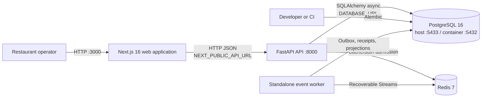

# System context

Last updated: 2026-10-19 (Milestone 8 runtime and operations boundaries).

RestaurantOS currently runs as a small modular-monolith-shaped application: one
Next.js frontend, one FastAPI API, one PostgreSQL database and a separately
started event worker. Local Compose supplies PostgreSQL and nonpersistent Redis;
the API, frontend and worker normally run on the host.



## Runtime responsibilities

| Component | Current responsibility |
|---|---|
| Next.js | Login/renewal/logout, browser and server credential transports, restaurant navigation, operational forms and dashboard |
| FastAPI routers | HTTP validation, dependency injection, status codes, and response mapping |
| Application services | Use-case orchestration, business rules, and explicit write transaction boundaries |
| Repositories | Focused SQLAlchemy persistence and analytics queries without HTTP knowledge |
| PostgreSQL | Operational records, users, session families, refresh-token digests and auth rate counters |
| Alembic | Ordered schema creation and future schema evolution |
| Docker Compose | Local PostgreSQL and Redis lifecycle |
| Event worker | PostgreSQL outbox relay/recovery and independent analytics, alerts and notification-sink groups |
| Redis Streams | Recoverable references; PostgreSQL owns facts, retries and completion |

## Boundaries and dependencies

The backend now follows the modular-monolith dependency direction established
by ADR 0001:

```text
FastAPI router -> application service -> domain/repository -> PostgreSQL
```

Pydantic schemas remain at the HTTP boundary and SQLAlchemy models remain in
the persistence boundary. Order state/payment rules are framework-independent.
The request dependency owns session lifetime, application command services own
transactions, and repositories never commit or roll back.

Authentication is the first feature-first module, `app/modules/auth`, containing
its router, schemas, service, domain and repo. `app/modules` is the primary home
for business features, and subsequent modules follow the same structure:
`service.py` for use cases, `domain/` for pure rules, and `repo/` for persistence.
Tenancy, audit, restaurants, catalog, orders and analytics now use these
module layers. Unused top-level business-layer compatibility folders have been
removed. Shared infrastructure remains outside modules. See
[ADR 0002](../adr/0002-feature-modules.md).

Principal lookup uses its own short-lived read session
so it does not open a transaction on a business command's session.

## Trust and configuration boundaries

- Browser-visible API configuration usually uses `NEXT_PUBLIC_API_URL`; the
  root-page connectivity probe still hardcodes the localhost API URL.
- Backend and Alembic share typed settings sourced from `DATABASE_URL`.
- Tests require a separate `TEST_DATABASE_URL` whose database name ends in
  `_test`; the harness refuses to truncate the development database.
- `ENVIRONMENT`, `LOG_LEVEL`, and `DATABASE_ECHO` are validated settings.
- Authentication uses Argon2id, short access JWT cookies, rotating opaque refresh
  cookies, server-side revocation/replay detection and PostgreSQL rate limits.
- CORS permits exact configured origins; unsafe operations also check Origin and
  a custom CSRF header. Production cookies require HTTPS on one shared host.
- Business routes require active identity and organization membership, then
  enforce Owner/Manager/Employee capabilities and restaurant assignments.
- Redis cache/auth adapters and the standalone event worker have independent
  bounded pools and failure policies. API business writes commit their events
  without worker publication. There is no object storage or external payment provider.
- `/health` is a process liveness response and does not query dependencies.
  No readiness endpoint is claimed or added in Milestone 0.
- Structured JSON logging includes a validated or generated request ID, which
  is also returned in the `X-Request-ID` response header. SQL echo is disabled
  by default and is explicitly configurable.

## Deployment context

The backend has a locked-dependency nonroot runtime Dockerfile; there is no
frontend Dockerfile or deployed environment. GitHub Actions provides validation.
The worker's host entrypoint does not establish container orchestration or M9
deployment. Startup never migrates; application migration/cutover requires the
[backup, write-pause and initialization procedure](../runbooks/event-maintenance.md).

M8 effects and receipts commit atomically per consumer. Revision watermarks and
episode identities fence stale facts. The dashboard stays on live SQL; low-stock
notifications are durable local stubs. Baselines suppress notifications until a
new episode, and no event/receipt/history or Stream pruning runs. Retained storage
growth is an operational limitation. External messaging, M9 deployment, M10 full
tracing and M11 broader analytics remain deferred. The
[freshness report](../milestone8/performance-milestone8.md) measures this local
configuration separately from the UI's 15-second visible polling cadence.


Business access resolves active organization membership and branch assignments
on every operation, then applies named capabilities and scoped queries. Owners
administer staff; Managers operate assigned branches; Employees read assigned
operations and advance preparation only. Audits share each mutation's PostgreSQL
transaction and are visible only to the organization's Owners. Local acceptance
passed 231 backend tests and 13 Chromium tests on 2026-10-02; the live database
was backed up, migrated and bootstrapped. See the tenancy runbook.
