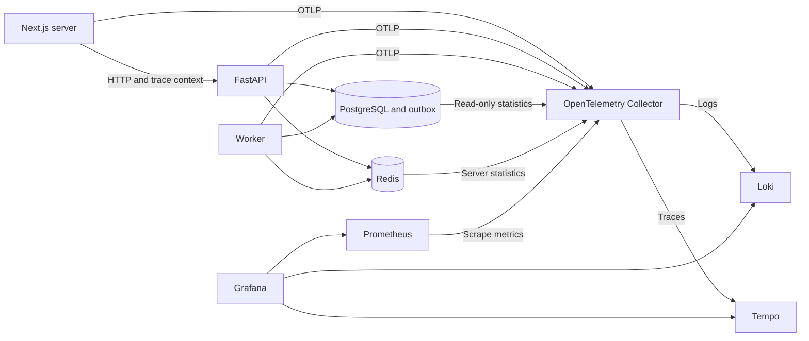

# Milestone 9: Observability and operational readiness

Status: Draft, revision 1; discussed scope accepted, saved document review pending
Updated and inspected: 2026-10-31 (Asia/Bangkok)
Inspection baseline: `bda038a7ad3fc88cc84cbc7a4c324c895363f8c0`; working tree clean before this document
Authorization: design discussion and this document only; no implementation, dependency installation, migration, deployment, commit, or publication.

The user accepted the decisions recorded below and requested this separate folder
and filename after reviewing the consolidated design. That request authorizes
saving the design; it does not establish approval of previously unseen technical
detail or demonstrate implementation feasibility.

## Goal and milestone identity

Make RestaurantOS failures and performance understandable without a debugger.
Provide a reproducible local operator environment for metrics, logs, traces,
alerts, and controlled incident exercises against the real application services.

The [master roadmap](../../RestaurantOS_Master_Roadmap.md) renumbered milestones
on 2026-10-31. Current M9 is observability; historical `docs/milestone9/` deployment
designs and S1/S2 evidence belong to current M15. Preserve those files and their
historical identifiers. This design lives separately at the user's request.

Success means an operator can follow a request through API, database, outbox and
worker, investigate a deliberately injected failure, and execute its documented
response. Local measurements establish local demo objectives only. Hosted
delivery, resource limits and service-level evidence remain M15 work.

## Existing implementation and evidence

| Inspected behavior | Evidence and implication |
|---|---|
| JSON logging allowlists extra fields and includes request IDs. Exception formatting can still include raw exception text. | [Logging](../../backend/app/core/logging.py). M9 must test and filter all enabled telemetry paths; existing formatting alone is not proof of safe export. |
| ASGI middleware selects and echoes request IDs and logs method, path, status and duration. It deliberately avoids attaching database exceptions. | [Request middleware](../../backend/app/http/request_middleware.py). Reuse correlation; normalize routes and sanitize exported attributes. |
| Commands persist a correlation ID with outbox events inside the business transaction. | [Event service](../../backend/app/modules/events/service.py), [outbox models](../../backend/app/modules/events/repo/models.py). Trace context is a new additive field, not existing behavior. |
| Publication and consumer execution already expose diagnostic identifiers. | [Worker runtime](../../backend/app/modules/events/worker/runtime.py), [execution](../../backend/app/modules/events/execution.py), [worker queries](../../backend/app/modules/events/repo/worker_queries.py). Preserve retry and receipt semantics. |
| API and standalone worker have separately configured database engines and pools. HTTP tests use NullPool. | [API database](../../backend/app/db/database.py), [worker database](../../backend/app/db/worker.py). Pool acceptance needs real pooled processes, not an inference from HTTP test configuration. |
| Health and bounded database readiness are separate, generic public endpoints. | [Health contract](../api/health.md). Preserve `/health` and `/ready`; Redis and monitoring failure do not become liveness dependencies. |
| Sales projection is eventually consistent and uses order creation date in UTC. Deletion can remove contributions. | [Analytics contract](../api/analytics-projection.md), [models](../../backend/app/modules/analytics/repo/models.py). Label it accurately; do not call it completion-date revenue or a monotonic sales counter. |
| Installed Next.js documents server startup instrumentation and runtime-specific imports. | `frontend/node_modules/next/dist/docs/01-app/02-guides/instrumentation.md` inspected locally. Use the installed documentation again before frontend implementation. |

Sources also include [README](../../README.md), [current state](../current-state.md),
root [engineering instructions](../../AGENTS.md), and
[frontend instructions](../../frontend/AGENTS.md). Current-state deployment headings
retain historical milestone numbers; the updated roadmap supplies the mapping.
Root instructions also retain historical PostgreSQL auth-limiter wording; preserve
the implemented Redis/local fallback policy rather than changing auth for M9.

## Requirements and observable acceptance

IDs in this document are stable and must be qualified by this design when other
milestone designs use the same IDs. All acceptance below is proposed, not executed.

| ID | Requirement | Observable acceptance criteria |
|---|---|---|
| R1 | Local five-service monitoring stack | Separate Prometheus, Grafana, Tempo, Loki and upstream OpenTelemetry Collector containers start together through a documented command; pinned configurations and data sources are reproducible. |
| R2 | Bounded resource use | Initial combined monitoring container memory budget is 2 GB within Docker's reported 7.49 GB allocation. Representative exercises report actual per-service/aggregate memory, CPU and disk use, dropped telemetry and restarts. A failing budget is reported and revised explicitly. |
| R3 | Server-side request tracing | Next.js server calls, API handling, SQL and Redis operations can be investigated through linked traces and logs. Direct browser API calls begin tracing at the API. No browser instrumentation is required. |
| R4 | Durable asynchronous correlation | Validated trace context is stored additively with outbox events. Publication and worker attempts link to the originating operation after restart. Legacy events without context still process correctly; existing correlation IDs remain usable. |
| R5 | Safe, best-effort diagnostics | Exported logs/errors/spans exclude seeded credentials, cookies, request bodies, SQL parameter values and sensitive business content. Bounded buffers/retries cannot block business operations during monitoring failure. Available counters/logs expose collection failures or drops. |
| R6 | Local access and retention | Grafana is localhost-accessible; storage services remain internal. Necessary host-mode ingestion is loopback-only. Metrics retain seven days and logs/traces three days, with configured cleanup and persistence across normal restart. Telemetry has no backup requirement. |
| R7 | Four operator dashboards | Provision service overview, database/Redis, background processing and business activity dashboards. Relevant panels link to filtered logs or traces. Collector health and telemetry loss appear in the overview. |
| R8 | Actionable local alerts | Sustained API errors, database saturation, old queued work and repeated job failure produce tested firing and resolution transitions, with local notification capture and linked response instructions. External delivery is deferred. |
| R9 | Two supported workflows | Host API/frontend development can use Docker monitoring; repeatable acceptance uses isolated containerized services and synthetic data. Acceptance does not migrate or fault the developer application database. |
| R10 | Measured operational proof | Run the six agreed failure exercises, define local objectives from a healthy baseline before final acceptance, and retain commands, workload, source/configuration, outcomes and recovery evidence. Complete applicable shared gates and milestone exit criteria. |
| R11 | Honest business signals | Show committed submissions/completions/cancellations, stock-related command rejections and low-stock state separately. Durable completed-sales values come from the existing projection, with accurate date semantics and freshness evidence. Retry/replay cannot inflate durable totals. |
| R12 | Limited infrastructure collection | Collect app query/pool/cache signals and read-only PostgreSQL/Redis statistics. Use a restricted monitoring identity. Record container resource usage during exercises; continuous host-wide monitoring is deferred. |

## Operator journeys and dashboards

1. Start monitoring when needed, open Grafana, and check service and collector
   health. Normal development remains usable without monitoring.
2. Find a slow or failing normalized API route in the service overview, inspect
   the relevant trace and linked sanitized logs, then identify database, Redis or
   application time. SSR requests include the Next.js server portion.
3. Follow a committed command into outbox publication and worker processing.
   Distinguish publication delay, queued work, retry delay, execution failure and
   completed durable effects. A retry is a new attempt, not a new business event.
4. Inspect database connections, pool pressure, query duration and lock statistics,
   or Redis latency, errors, cache hit behavior, memory and evictions.
5. Inspect operational business activity and the completed-sales projection.
   These Grafana panels are for a trusted local operator, not tenant-facing
   RestaurantOS screens or a replacement for authorized application APIs.
6. Receive a locally captured alert, follow its runbook, perform recovery, and
   verify alert resolution and business correctness.

Use bounded metric dimensions such as service, normalized route, method, outcome,
event type and consumer. Do not put tenant, user, order, event or trace IDs in
metric labels. Correlation identifiers belong in sanitized logs/span metadata.
Do not use raw URLs, SQL text/parameters, Redis keys or exception messages as
metric dimensions. Treat expected authorization failures, stock conflicts and
rate limits separately from unexpected server failures.

## Architecture and interfaces

Use the upstream **Collector Contrib** distribution for its database/Redis
receivers. This is still the one agreed collector container, not an additional
service. Official receiver documentation supports this direction:
[PostgreSQL](https://github.com/open-telemetry/opentelemetry-collector-contrib/blob/main/receiver/postgresqlreceiver/README.md)
and [Redis](https://github.com/open-telemetry/opentelemetry-collector-contrib/blob/main/receiver/redisreceiver/README.md).
Pin and inspect the exact receiver versions and required permissions during
implementation; documentation on `main` is not a tested dependency lock.

Applications send telemetry to a configurable OTLP endpoint; the collector
filters, batches and routes it. Prometheus scrapes the collector's metric export
and its own/collector health as applicable. Logs use Loki's
[native OTLP endpoint](https://grafana.com/docs/loki/latest/send-data/otel/);
traces use [Tempo's OTel integration](https://grafana.com/docs/tempo/latest/set-up-for-tracing/instrument-send/set-up-collector/otel-collector/).
Keep existing stderr JSON diagnostics available when remote export fails. Avoid
double-ingesting the same application logs through both stdout collection and
OTLP. A Docker socket mount is not an assumed requirement.

Use server-only Next.js initialization with runtime guards and explicit trusted
API propagation. Do not forward arbitrary cookies, baggage or credentials along
with trace headers. Preserve existing credentialed browser calls, server access
cookie forwarding, CSRF checks, route URLs and renewal behavior.

Business telemetry should be exposed through narrow feature-owned query/service
interfaces; shared observability infrastructure must not acquire business write
responsibility. Do not give Grafana unrestricted direct database access. Prefer
read-only aggregate collection with explicit timeouts and cadence, avoiding
expensive full-history scans on every scrape.

Proposed implementation locations: backend shared telemetry wiring under
`app/core/`, HTTP instrumentation under `app/http/`, DB hooks under `app/db/`,
event-specific changes in `app/modules/events/`, feature-owned aggregate queries,
frontend server instrumentation, new monitoring Compose/configuration assets,
validation scripts, dashboard/alert definitions, and operational documentation.
Exact filenames are implementation details. Preserve the modular monolith.

## Trace context and migration

Proposed representation: an optional, bounded W3C trace-parent value on the outbox
row, containing validated trace ID, span ID and flags. Do not store arbitrary
baggage, headers or vendor state. Invalid/unavailable context is omitted without
rejecting a business command. Context is written with the event in the existing
business transaction, with no network export inside that transaction.

Carry context through typed event/claim plumbing without changing business event
payload semantics. Worker attempts use separate spans/traces linked to the
originating context, preserving event ID, correlation ID and attempt identity.
[OpenTelemetry links](https://opentelemetry.io/docs/specs/otel/overview/) support
relationships between originating requests and asynchronous processing. Do not
hold a request span open while waiting for asynchronous delivery.

Add a new nullable Alembic column without backfilling fabricated context. Preserve
one migration head, legacy events, delivery/receipt history and replay protection.
Review downgrade SQL: removing only new trace metadata must never discard durable
business/event history, and downgrade requires compatible application code.
Test clean and representative legacy upgrades plus Alembic drift detection using
the disposable migrations gate. Application database migration remains a separate
explicit operation under the relevant backup/maintenance procedure.

Stored identifiers can survive longer than Tempo's three-day retention. Older
links may no longer resolve, and legacy events cannot reconstruct historical
traces. Existing retained correlation facts remain available through authorized
operator diagnostics. Telemetry retention does not prune business/audit history.

## Business metric semantics

Committed lifecycle activity is operational observation, not an accounting ledger.
Emit an observation only after successful commit and not on idempotent replay.
Process-local observations can reset or be lost on crashes/export failure; expose
that limitation. Use retained database facts/projections for durable totals.

Completed-sales panels must say that values represent retained completed orders
grouped by **creation date in UTC**, matching the existing projection. Deletion
can reduce the value, so use a gauge/derived query rather than a monotonic counter.
PostgreSQL fixed-precision money stays authoritative; exported numeric metrics
are for visualization, not financial calculation. Keep the displayed period
explicit and do not silently combine incompatible currencies.

Report collection time separately from projection progress. A successful scrape
does not prove all pending events were applied. Pair sales with relevant pending
delivery age/count and clearly label unknown/stale collection. Derive any stronger
freshness claim from durable delivery/receipt evidence, not merely the most recent
successful worker timestamp.

Count stock-related command rejections separately from low-stock alert episodes
and active alert state. A rejected retry can be another observed failed attempt;
it is not automatically a distinct business incident. Expanded finance contracts,
tenant reporting and analytics redesign remain M10.

## Resources, privacy and telemetry failure

The user reports 7.49 GB available to Docker. The initial monitoring total is
2 GB, leaving roughly 5.5 GB for application services and Docker overhead; this
is a planning budget, not proven capacity. Partition container limits after the
first measurement. Do not run duplicate developer and acceptance stacks during
resource acceptance. The synthetic local alert receiver is test infrastructure,
not a sixth permanent monitoring backend; account for its resource use too.

Retain metrics seven days and logs/traces three days. Configure actual retention
cleanup and measure disk growth; age retention alone does not bound burst volume.
Set bounded ingestion/export queues and timeouts, document disk constraints, and
report loss or shortened retention explicitly if resource limits intervene.
Collect 100% of traces during declared local acceptance exercises; do not trust
an arbitrary incoming sampling flag to defeat the exercise's sampling policy.
Normal-development sampling and per-service limits remain measured tuning values.

Filter at instrumentation/log construction, with collector filtering as defense
in depth. Disable unsafe automatic SQL/Redis command and HTTP header/body capture.
Use synthetic secret canaries to inspect all enabled export paths, including
framework and exception instrumentation. Keep operator credentials outside tracked
configuration. Metrics backends stay on an internal network; bind only required
UI/host-ingestion listeners to loopback, with Grafana authentication configured.

Telemetry is best-effort and disposable: bounded retries, observable drops,
no backup, and no coupling to transaction success. When the collector/backend is
down, retain bounded local diagnostics; business services continue normally.
Some loss evidence may disappear if its process also crashes. Do not claim exact
accounting for every dropped record or continuous alert coverage while Grafana
itself is unavailable. After recovery, make missing/stale telemetry distinguishable
from healthy zero activity.

## Alerts, service objectives and response

Grafana evaluates the agreed local alerts and sends to a local receiver during
exercises. Verify firing, deduplication where configured, recovery/resolution and
no-data behavior. External email/chat delivery and hosted alert reliability are
deferred. Monitoring should expose its own unavailable/stale sources.

Measure a healthy baseline with a declared dataset, command/read mix, concurrency,
duration, warmup and exact revision. Then agree numeric latency, unexpected-error
and event-freshness targets before final acceptance. Keep expected business
conflicts and deliberate failure traffic separate from healthy-load objectives.
Alert evaluation intervals, sustained windows, minimum traffic counts and recovery
windows must be documented and tested; do not invent final thresholds now.

Create/update response instructions for DB connection exhaustion, Redis outage,
queue backlog, repeated job failure, failed migration and rollback. Reuse existing
[worker](../runbooks/event-worker.md), [maintenance](../runbooks/event-maintenance.md)
and [Redis](../runbooks/redis-cache.md) procedures. Migration/rollback documentation
must preserve maintenance, compatibility and backup requirements; M9 does not
authorize a live destructive migration or establish hosted recovery evidence.

## Delivery slices and validation

| Slice | Scope and prerequisites | Evidence required |
|---|---|---|
| S1 Monitoring foundation | Pinned five-container stack, storage, collection, provisioned data sources and both network modes | Startup/shutdown/restart checks, retention configuration, resource baseline, missing-source visibility; R1/R2/R6/R9 |
| S2 Request diagnostics | S1; server-only Next/API instrumentation, logs/errors, DB/Redis and pool signals | Trace a real SSR/API call, normalize routes, verify filtering and unavailable-export behavior; R3/R5/R12 |
| S3 Durable worker diagnostics | S1/S2; additive migration and event/claim propagation | Legacy upgrade, restart correlation, retries, replay correctness, old-context behavior; R4/R5 |
| S4 Dashboards and alerts | S2/S3; bounded business queries and local notification receiver | Four reproducible dashboards, meaningful links, durable-total reconciliation, firing/resolution/no-data cases; R7/R8/R11 |
| S5 Operational acceptance | S1-S4; declared baseline and agreed numerical objectives | Six fault exercises, memory/disk/CPU evidence, runbooks, relevant full gates and roadmap exit criteria; R2/R10 and integrated R1-R12 |

### Six accepted failure exercises

| Exercise | Required signal and recovery proof |
|---|---|
| API failure | Sanitized linked error/trace, dashboard signal, alert firing and resolution |
| Database connection exhaustion | Real pool pressure and bounded failures; recovery without leaked sessions or incorrect writes |
| Redis outage | Existing cache/auth/worker degradation contracts remain correct and visible; recovery preserves durable effects |
| Worker stopped | Durable backlog/age increases, alert fires, restart processes eligible work and reconciles effects |
| Repeated job failure | Attempts/retries/terminal failure are distinguishable; authorized inspection/replay follows existing semantics |
| Monitoring outage | API/worker continue correct business operations under bounded telemetry pressure; recovery shows stale/missing intervals and available loss evidence |

Run faults only in isolated synthetic environments. Prove connection/lock overlap
through explicit synchronization where relevant, not sleeps. Verify injected-fault
cleanup, and avoid sensitive browser traces. Do not add production fault endpoints.

Follow [testing guidance](../testing/README.md) and
[dependency locking](../testing/dependencies.md). Implementation will need backend
unit/integration/static, frontend tests/static/build, browser, migrations, image
and baseline gates as applicable; final milestone acceptance requires all ten
shared gates and retained observability-specific evidence. Keep the required
`Milestone 6 acceptance` check name unchanged. If enforcement changes, reverify
according to [enforcement policy](../testing/enforcement.md).

Use `./scripts/validate.ps1` for full Windows validation. Partial commands such as
`./scripts/validate.ps1 -Gate migrations -NoInstall` remain partial evidence.
No shared gate, dependency installation, prototype, container startup, fault
exercise or application migration was run during this design task.

## Alternatives and remaining evidence

| Choice | Decision and tradeoff |
|---|---|
| Separate containers versus all-in-one image | Separate services accepted for independent failure exercises and explicit limits; more configuration to maintain. |
| Upstream collector versus vendor distribution | Upstream accepted; Contrib provides required integrations. Pin/test the actual component set. |
| Browser plus server tracing versus server only | Server only accepted; browser navigation/client timings are outside M9. |
| Dedicated error tracker versus existing stack | Loki/Tempo/Grafana accepted; issue assignment/resolution workflow is deferred. |
| Correlation-only versus persisted trace context | Additive trace storage accepted for restart-safe links; requires migration and compatibility proof. |
| Continuous host monitoring versus exercise measurements | Exercise resource capture accepted; avoid expanding into host-wide monitoring infrastructure. |
| Durable telemetry versus bounded best effort | Best effort accepted; data loss is permitted and disclosed, business/audit durability is unchanged. |

No major product/architecture choice remains open. The following are deliberately
unproven implementation details, not new accepted guarantees: exact image/SDK
versions, collector receiver permissions, final field/constraint names, per-service
memory split, disk budget, scrape intervals, normal sampling, business-query cost,
and baseline-derived alert/objective values. Resolve them with small isolated
checks during authorized implementation. If the five-service stack cannot fit
the agreed resource budget, retain the failure and propose a scoped adjustment.

The initial feasibility check should start the pinned stack with a small synthetic
request/event workload, verify export and privacy, and measure memory/disk growth.
Its success signal is usable telemetry within limits without harming application
behavior; failure triggers configuration/resource review. It was not executed
or separately authorized by this documentation request.

## Decision history and review status

All discussion decisions below occurred on 2026-10-31 (Asia/Bangkok).

| Decision | User evidence |
|---|---|
| Five separate containers with upstream Collector | "Yes, use this" |
| Server-side tracing, defer browser | "A sounds good" |
| Stack-based error tracking | "This will work" |
| Docker capacity | "My docker has 7.49Gb memory" |
| Retention, local alerts/access, optional startup, initial 2 GB and acceptance sampling | "Yes" to the consolidated defaults |
| Business signals and durable-total distinction | "Yes" |
| Six failure exercises and measurement-first objectives | "yes" |
| Host development and isolated container acceptance | "A" |
| Additive trace-context migration | "Yes" |
| Four provisioned operator dashboards | "Yes this works" |
| Limited infrastructure scope and restricted monitoring identity | "Yes" |
| Best-effort disposable telemetry without backups | "Yes" |
| Separate document location and permission to write | "Create a new folder in docs called \"milestone9-observability\" then save the design as milestone-9-observability-design I dont wanna confuse it in the same folder" |

This saved revision is Draft pending review of its concrete technical detail.
Previously accepted scope remains accepted; silence is not approval of new detail.
After explicit acceptance, record the approved revision/date here. Implementation,
GitHub issue publication and deployment require their own authorized scope.
