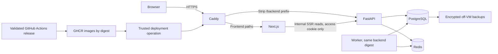

# Milestone 9: Production containers, delivery, and deployment

Status: Changes proposed, revision 2

Updated and inspected: 2026-10-27 (Asia/Bangkok)

Inspection baseline: `e683a86aed7b11edbad7c8e2daf4107f907c8541`;
tracked working tree unchanged; revision 1 was already untracked in
`docs/milestone9/` before this revision.

Approval: the user's 2026-10-27 review states, "Architecture approved with
revisions required before implementation." The accepted architecture and prior
recovery decisions remain the baseline. Revision 2's security mechanisms,
resource settings, thresholds, and operational defaults are proposals for review,
not automatically approved changes. This task authorizes design revision only:
no application changes, provisioning, migration, workflow alteration, issues,
commit, push, or deployment.

### Revision 2 change summary

- Preserve R1-R14 and S1-S6; add owners, dependencies and phase checkpoints.
- Specify restricted SSH deployment, exact-release approval, GHCR pulls, runtime
  secret custody/rotation, and a fallback when native approval cannot be used.
- Define stable proxy identity and actual external-IP, cookie, SSR, and
  tenant-cache tests rather than inferring correctness from same-origin routing.
- Propose OCI Standard Object Storage, public-key backup encryption, create-only
  writes, separately authorized retention, quota arithmetic and complete-host-loss
  restoration evidence.
- Propose per-host memory/connection budgets, bounded processes, storage/patch/
  reboot procedures, measurable capacity checks, and Redis no-eviction handling.
- Require seven M8 failure scenarios without changing its contracts; distinguish
  reconstructed work, diagnostic reconciliation, and explicit maintenance rebuild.
- Record repository/document disagreements and unresolved external facts.

## Goal and boundaries

Deploy the existing modular monolith on OCI with individual, manually provisioned
accounts and durable, tenant-isolated data. Learn Linux administration, container
delivery, HTTPS routing, controlled migration, and recovery with a target ongoing
infrastructure cost of zero. Demonstrate repeatable releases and restoration
before onboarding users who depend on stored data.

This is a public HTTPS application with private accounts, not a shared-credential
playground. There are no periodic resets of application user data. Self-service
registration, email verification, invitation workflows, and self-service password
recovery are deferred. Document the existing trusted onboarding/offboarding
capabilities and their limits; do not assume a password-reset capability exists.

Keep Python 3.12, Node 24, Next.js 16, PostgreSQL 16, Redis 7, and the existing
feature boundaries. Kubernetes, clusters, managed databases, application object
uploads, business changes, and M10 tracing/metrics dashboards are outside this
slice. Backup object storage is operational infrastructure, not an upload feature.
Terraform follows experience with a manual deployment, per the roadmap.

### Roadmap alignment and differences

- The roadmap initially suggests managed PostgreSQL. The user instead selected
  self-hosted PostgreSQL and Redis to minimize cost and learn operations. This
  trades managed recovery and availability for operator responsibility.
- The roadmap describes staging/demo and synthetic demo data. The user clarified
  individually provisioned real accounts and durable private data. Synthetic
  staging/demo fixtures remain separate; user records must never be publicly
  exposed or reset as demo data. This scope clarification needs to be reflected
  in the roadmap when the document is accepted, without marking M9 complete.
- The roadmap's short release diagram is expanded into an explicit maintenance
  sequence. Candidate code must not serve against an incompatible schema.
- Earlier local M8 measurements do not establish ARM VM capacity or M8 acceptance.
  Resolve the release baseline and outstanding acceptance evidence explicitly.

## Existing implementation and evidence

| Observation | Inspected evidence |
|---|---|
| Backend image has locked dependencies, non-root runtime, and liveness check; it is single-stage. | [Dockerfile](../../backend/Dockerfile) |
| Worker is a separate process with its own bounded DB pool and shutdown handling. | [Entry point](../../backend/app/worker.py), [worker operations](../runbooks/event-worker.md) |
| Frontend has no production Dockerfile and no standalone output configuration. | [Next config](../../frontend/next.config.ts), [system context](../architecture/system-context.md) |
| Browser and SSR already have separate API configuration; SSR forwards only access cookies. | [Browser client](../../frontend/lib/api/client.ts), [server client](../../frontend/lib/api/server.ts) |
| Refresh-cookie creation and deletion currently hardcode `/auth`. | [Auth router](../../backend/app/modules/auth/router.py) |
| Exact trusted proxy peers are checked by application code. Uvicorn rewriting must remain disabled for that contract. | [Client IP handling](../../backend/app/modules/auth/dependencies.py), [auth runbook](../runbooks/authentication.md) |
| CI runs ten shared gates with required aggregate `Milestone 6 acceptance`. | [CI workflow](../../.github/workflows/ci.yml), [testing strategy](../testing/README.md) |
| Event maintenance requires actual write/worker quiescence, revision inspection, verified backup, scoped initialization, and reconciliation. | [Maintenance runbook](../runbooks/event-maintenance.md) |
| There is no deployed environment claimed; storage retention/pruning remains limited. | [Current state](../current-state.md), [system context](../architecture/system-context.md) |

ADRs [0001](../adr/0001-modular-monolith.md),
[0002](../adr/0002-feature-modules.md), and
[0003](../adr/0003-authentication-sessions.md) remain architectural sources.

### Disagreements and implementation gaps

These are inspected facts or design-to-code gaps, not permission to fix unrelated
code in this task. Line references are for the inspection baseline above.

| Exact reference | Difference and treatment |
|---|---|
| [AGENTS.md](../../AGENTS.md), lines 98-101; [ADR 0003](../adr/0003-authentication-sessions.md), line 35; [auth limiter](../../backend/app/modules/auth/rate_limit.py), `_mode`, `admit`, `finalize`; [Redis runbook](../runbooks/redis-cache.md), Authentication semantics | Historical PostgreSQL-admission text conflicts with current Redis admission/local outage enforcement. Preserve M7 behavior and quotas; flag documentation synchronization for implementation, not a limiter rewrite. |
| [Auth router](../../backend/app/modules/auth/router.py), lines 17, 51; [ADR 0003](../adr/0003-authentication-sessions.md), lines 17-18 | `/auth` cookie path cannot serve browser `/backend/auth`. Accepted deployment requires explicit path configuration and ADR clarification, not weaker cookie scope. |
| [API DB setup](../../backend/app/db/database.py), lines 23-28; [worker DB setup](../../backend/app/db/worker.py), lines 12-20 | API pool is not explicitly sized; worker already bounds its pool to `3 + relay_concurrency + 1`, no overflow, five-second checkout. Proposed API pool settings are a small infrastructure change; do not claim they exist. |
| [Settings](../../backend/app/core/config.py), lines 22-34; [Dockerfile](../../backend/Dockerfile) | Current settings consume environment variables or a backend-root `.env`; file-secret lookup is not configured. Mounting that file read-only at `/app/.env` fits the current loader. Compose secrets alone do not make arbitrary `_FILE` variables work. |
| [Catalog contract](../api/catalog-cache.md), first three paragraphs | Existing catalog caches are authenticated and tenant-scoped, not a public anonymous catalog. Do not introduce public catalog access or proxy response caching. |
| [Frontend proxy](../../frontend/proxy.ts), lines 8-12; [server client](../../frontend/lib/api/server.ts), lines 18-23; [SessionMenu](../../frontend/features/auth/SessionMenu.tsx), lines 18-25 | Private/no-store headers, uncached access-cookie reads, identity-change reload and BFCache handling exist. Hosted cache isolation still needs end-to-end proof; no passing hosted result is inferred. |
| [Auth runbook](../runbooks/authentication.md), Local setup; [password policy](../../backend/app/modules/auth/domain/policies.py), lines 14-16; [CLI](../../backend/app/modules/auth/cli.py), `run`/`main` | Runbook recommends 15-128 characters while current domain validation allows 6-128. Use operator-generated passwords of at least 15 characters; no password-policy or recovery feature change is in M9. CLI has create/disable/cleanup, no password reset. |
| [Roadmap](../../RestaurantOS_Master_Roadmap.md), M9 Initial deployment shape and Exit criteria | Managed DB and synthetic demo framing differ from accepted self-hosting/private durable users. Keep synthetic examples separate; update roadmap evidence only with accepted scope and actual results. |

No inspected evidence establishes an incompatibility in M8's durability model.
The failure matrix below is still required on the proposed containers/host; a
new failure must be recorded separately with event/receipt evidence and the
smallest proposed correction rather than broadening M9 into an M8 redesign.

## Agreed environment layout

| Resource | Application VM | Testing/recovery VM |
|---|---|---|
| Preferred shape | OCI `VM.Standard.A1.Flex`, ARM64 | Same |
| Initial CPU | 1 OCPU | 1 OCPU |
| Initial memory | 8 GB | 4 GB |
| Initial boot volume | 50 GB | 50 GB |
| OS preference | Ubuntu Server 24.04 ARM64, exact eligible image to verify | Same |
| State | Durable user data | Isolated synthetic fixtures or controlled restore rehearsal |
| Availability | Persistent application environment | Rebuildable separate host; availability not guaranteed |

The 1-OCPU application budget is provisional. Use measured workload results to
decide whether it is adequate; a functional pass is not capacity evidence.
Both hosts use Docker Engine and Compose v2. Build application images in GitHub
Actions rather than on the hosts. The smaller testing VM can verify correctness
and recovery, but its performance is not a measurement of the 8-GB application VM.

Oracle currently documents 2 A1 OCPUs and 12 GB total for Always Free tenancies,
200 GB combined boot/block volumes in the home region, capacity shortages, and
idle reclamation. The proposed layout fits those published compute/storage
allowances; exact tenancy eligibility, image, ancillary resources, and actual
capacity remain unverified. Check the console before provisioning; do not rely
on temporary trial credits. A second VM is neither guaranteed capacity nor an
automatic standby. See [Oracle Always Free resources](https://docs.oracle.com/en-us/iaas/Content/FreeTier/freetier_topic-Always_Free_Resources.htm)
and [trial boundaries](https://docs.oracle.com/en-us/iaas/Content/FreeTier/freetier.htm),
rechecked on 2026-10-27. These sources are policy evidence, not a tenancy inspection.

## Architecture and trust boundaries

Each VM runs Caddy, Next.js, FastAPI, one worker, PostgreSQL, and Redis in separate
containers. API and worker use the same backend image digest with different
commands. PostgreSQL is authoritative; Redis is cache/admission and recoverable
event transport. Retain current transactional audit, stock, replay, and consumer
contracts.

Application and testing have separate hostnames, secrets, database credentials,
volumes, Redis state, and deployment identities/configuration. Testing must never
connect to the application database. Production restore data, if needed for a
trusted recovery exercise, stays access-restricted and is not a public fixture.
Prefer synthetic fixtures for ordinary staging tests.

Only Caddy publishes application ports 80/443. Administrative SSH is a separate,
restricted access path. PostgreSQL, Redis, API, and Next.js have no direct public
port mappings. Proposed network separation gives the frontend access to API,
while only API/worker/maintenance jobs reach data services. Persist PostgreSQL
and Caddy certificate state; never use `compose down -v` as normal host shutdown.
Docker published ports can bypass UFW, so verify exposure externally and combine
OCI rules with appropriate host/Docker rules. See [Docker firewall behavior](https://docs.docker.com/engine/network/packet-filtering-firewalls/).

### Public routing and authentication

| Interface | Hosted setting/behavior |
|---|---|
| Browser frontend | `https://<environment-host>/` |
| Browser API | `/backend/<existing-api-path>`; Caddy strips only `/backend` |
| Browser API base | `NEXT_PUBLIC_API_URL=/backend` |
| SSR API base | `API_URL=http://api:8000` |
| Access cookie | Host-only, HttpOnly, Secure, SameSite=Lax, path `/` |
| Refresh cookie | Same security attributes; path `/backend/auth` hosted, `/auth` locally |
| Unsafe requests | Existing exact trusted Origin and `X-CSRF-Protection: 1` |

The refresh-cookie path needs an explicit validated backend setting used by both
issuance and deletion. Proposed name: `AUTH_REFRESH_COOKIE_PATH`. It does not
rename the backend `/auth` routes or widen the cookie to `/`. Update ADR 0003's
deployment-path clarification with implementation; preserve all rotation/replay
and browser renewal rules. A gateway-only prefix strip does not fix browser
cookie path matching.

Use the same relative browser base in testing and application builds so the exact
frontend digest is promotable. Public Next.js variables are fixed at build time;
server-only API origins and secrets are runtime configuration. Installed Next.js
deployment, output, and environment-variable documentation was consulted under
`frontend/node_modules/next/dist/docs/`; implementation must consult the relevant
installed guides again. Standalone output with copied static/public assets is the
proposed packaging default, subject to runtime verification.

Replace the homepage localhost probe. Verify prefix-aware redirects, trailing
slashes, OpenAPI/docs paths if exposed, and browser renewal return paths. Do not
opportunistically rename existing API namespaces. Keep CORS exact, secure cookie
checks enabled, and server-side cookie renewal forbidden.

Caddy is the directly exposed edge; no CDN or second public proxy is assumed.
Proposed Compose design reserves one fixed Caddy IPv4 address on a dedicated
proxy-to-API bridge, with an explicit IPAM subnet checked against VCN/host routes.
Only Caddy and API join that bridge. Next.js uses a different API bridge, while
API/worker/PostgreSQL/Redis use a separate data network. Trust only Caddy's exact
address in `AUTH_TRUSTED_PROXY_IPS`, not a subnet, host gateway or all private IPs.
Recreating Compose must reserve the same address or fail; adding another proxy
requires explicit trust review. Do not attach arbitrary containers to this bridge.
The host administrator remains inside this trust boundary.

Keep Uvicorn `--no-proxy-headers` and the current right-to-left application check
in [client_ip](../../backend/app/modules/auth/dependencies.py). Caddy must ignore
untrusted incoming forwarding values, set X-Forwarded-For from the external
connection, and replace/remove alternate identity headers such as `Forwarded`
and `X-Real-IP` so future adapters cannot trust attacker-supplied values. Default
Caddy behavior rejects untrusted incoming `X-Forwarded-*`; verify our exact
configuration/image rather than trusting the default description alone.
See [Caddy proxy defaults](https://caddyserver.com/docs/caddyfile/directives/reverse_proxy).

Internal SSR reads send only the access cookie, without forwarded client-IP,
refresh-cookie or arbitrary incoming browser headers. API sees the untrusted
Next.js peer for those reads; they do not execute login or refresh admission.
Browser login/refresh/logout always go through Caddy. SSR cannot rotate cookies
or proxy authentication mutations. Cookie-path changes must cover all error
handlers that clear cookies as well as the normal logout response.

#### Gateway and session-isolation proof (R3-R5; S1, repeated S3)

1. In local gateway tests use controlled distinct source peers; in staging use
   two genuinely distinct public egress addresses (not two tabs behind one NAT).
   Temporary test-only instrumentation asserts API `request.client` and resolved
   `client_ip` match the known edge connection. Record only client A/B labels,
   response statuses and pass/fail comparisons, not raw IPs or credentials.
2. Exercise wrong-password attempts from A up to current pair/IP thresholds;
   B with a distinct source must retain independent allowance. Test refresh
   IP accounting separately with distinct families and known fixed-window times.
   Sharing an actual public NAT legitimately shares IP quota; do not alter limits
   to hide that. Healthy login success does not consume credential-failure quota.
3. Repeat with forged single/multiple X-Forwarded-For, `Forwarded`, X-Real-IP,
   host/proto headers and a direct untrusted internal peer. None changes the
   external client's accounting identity. Confirm direct API access is blocked.
4. Assert secure host-only cookies and exact paths through login, access expiry,
   serialized multi-tab renewal, lost-refresh-response handling, logout and
   rejected-origin/missing-CSRF requests. SSR 401 must reach browser renewal,
   without refresh cookies or tokens in HTML/storage/logs. Repeat after Compose
   down/up and host reboot to prove the trusted peer stays stable.
5. Create tenants A/B with conspicuous synthetic markers. Alternate authenticated
   API, HTML and RSC/navigation requests for identical URLs, warming A's browser,
   Next.js and Redis caches first. Foreign IDs return scoped errors and B never
   receives A markers in response bodies, initial HTML, RSC payloads or DOM.
   Reverse A/B, revoke membership/assignment, and repeat on cache hits.
6. In one browser profile log out A, log in B, use Back/Forward, restored tabs,
   refresh and expired-session renewal. Confirm protected data clears and renewed
   identity cannot retain A's protected content. A full reload/BFCache check must
   be tested, not assumed from no-store headers. Previously downloaded data
   cannot be retroactively erased from a user's memory or saved files.

Keep server `fetch` no-store and dynamic cookie access. Do not add `use cache`,
shared RSC/HTML caching or a Caddy cache to authenticated routes. Next static
assets may cache by content identity; they must contain no tenant data. Current
Redis catalog cache is reusable within a permitted organization/resource after
live authorization, not keyed by individual user and not a permission grant.
Its ten-second source-age bound and live stock reads remain unchanged. A future
anonymous catalog is out of scope. Evidence: [catalog contract](../api/catalog-cache.md),
[proxy](../../frontend/proxy.ts), [SSR helper](../../frontend/lib/api/server.ts),
[session clearing](../../frontend/features/auth/SessionMenu.tsx). Installed Next.js
16 `self-hosting`, `caching-without-cache-components`, and environment-variable
guides were consulted; no frontend code was changed.

### Deployment identity and secret custody (R1-R3, R6-R9; S2-S5)

The following is a proposed simple host security model, not existing provisioning:

- A named human administrator has a personal SSH key and sudo; root/password SSH
  login is disabled. Verify a second working session/console recovery before
  hardening access. Human admin keys are separate from deployment keys.
- Each host gets a separate Ed25519 CI deployment key. Store the application
  private key only in its protected GitHub environment; staging uses a different
  secret. The runner creates a mode-0600 temporary key and pinned `known_hosts`,
  uses strict host-key checking, disables shell tracing and destroys temporary
  credentials on exit. Verify host fingerprints through OCI console/admin access,
  never by trusting `ssh-keyscan` from the deployment's network path. Rebuilds
  require deliberate fingerprint replacement. Rotate by installing a second key,
  verifying it, switching the environment secret and revoking the old key.
- `ros-deploy` has no interactive shell authorization, Docker-group membership,
  forwarding, agent forwarding, PTY or general sudo. Its authorized key forces a
  root-owned deployment wrapper; one fixed sudo rule permits only that wrapper.
  Accept only an allowlisted release ID and fixed verbs: inspect, stage/promote,
  resume or compatible app rollback. Reject shell fragments, arbitrary paths,
  supplied Compose files, environment overrides, image repositories and digests
  absent from the verified release manifest. Do not evaluate `SSH_ORIGINAL_COMMAND`.
- Root-owned templates/wrapper and a sanitized fixed environment control Docker.
  CI cannot upload arbitrary executable release scripts or mounts. Changes to
  these host-control files need separate trusted admin installation/review.
  Signed/verified source provenance and manifest allowlisting restrict what is
  pulled; they are not a sandbox against a malicious authorized application image.
  A compromise of approved release code or the root wrapper may compromise the
  host. Never mount the Docker socket into application containers. Docker daemon
  access is effectively host-root authority; a forced SSH command alone is not
  sufficient if it can accept arbitrary Docker inputs.
- Prefer public GHCR images for this already-public repository, permitting
  anonymous digest pulls without a long-lived host registry token. Explicitly
  verify package visibility; it is separate from repository visibility. If private
  packages are chosen, use an expiring machine credential with only `read:packages`,
  protected in root-only Docker configuration, passed via password-stdin and
  rotated independently; never reuse a CI publisher token. CI publication uses
  short-lived `GITHUB_TOKEN` with `packages: write` only in the trusted publisher.

Application secrets are provisioned through the trusted admin path, not a public
release artifact or build argument. Default host layout: `/etc/restaurantos/`
root-only configuration/secrets; `/opt/restaurantos/releases/` root-owned reviewed
release manifests/templates; `/var/lib/restaurantos/` private operational state
and volumes. Parent secret directories mode 0700; application secret files
root-owned, group-readable only by their verified container GID (0440). Validate
numeric ownership on ARM images. No application process can modify host secrets.

Use per-service Compose file secrets/read-only mounts. Backend API/worker receive
one settings-format file mounted at `/app/.env`, matching the existing loader;
their file includes only required database/Redis/auth values. Maintenance jobs
get a separately protected DB credential. Next.js gets only server API settings
and no DB/auth signing secrets. PostgreSQL receives its secret through the pinned
image's supported password-file mechanism; verify it for the selected image.
Compose file secrets are bind mounts, not encrypted secret storage or a host-root
boundary. File-source uid/gid/mode remapping cannot be relied on; verify actual
host ownership/read access. Avoid container environment injection where the
current file loader works. Do not print settings, expanded `compose config`,
`docker inspect` environment dumps, DSNs, `set -x` or passwords in CLI arguments.

Keep a protected off-VM operator recovery inventory of runtime secrets, DB/Redis
credentials, DNS/OCI recovery access and reviewed configuration after each rotation.
Encrypt/protect it independently of public Git artifacts; successful recovery
must not depend on reading a lost host or retrieving plaintext GitHub secrets.
The backup decryption identity remains separate from ordinary runtime secrets.

Separate DB runtime DML, migration/ownership, and backup-read credentials where
the existing triggers/model grants permit; verify clean/legacy grants and scoped
maintenance `session_user` provenance in S3. Runtime must not become DB superuser
just to simplify releases. Keep recovery/admin credentials offline from normal
containers. No new business table is required for these roles/configuration.

Rotation is an explicit maintenance operation: replace secret file atomically,
update DB/Redis credentials using the trusted operation, restart affected pools,
verify login/worker effects, then remove old credentials. JWT-key compromise
also requires session-family revocation; merely rotating JWT signing does not
revoke stored refresh families. Preserve the auth runbook's rate-secret/bucket
reset implications. Retain decryption keys for old backups until their expiry.

Untrusted PR jobs receive no SSH keys, runtime secrets, OCI identity, registry
publisher rights or production approval token. Do not check out PR code with
privileged `pull_request_target` or trust PR-generated scripts/artifacts in a
privileged workflow. Bind CI, builds, manifest, staging and approval to the exact
main commit/run, including full M6 acceptance. Pin privileged actions to reviewed
commit SHAs. Test a fork PR and a mismatched release manifest: neither may deploy.

Evidence: [Docker security](https://docs.docker.com/engine/security/),
[Compose secrets](https://docs.docker.com/compose/how-tos/use-secrets),
[file mount limitations](https://docs.docker.com/reference/compose-file/services/),
[GHCR authentication](https://docs.github.com/en/packages/working-with-a-github-packages-registry/working-with-the-container-registry),
and current [settings loader](../../backend/app/core/config.py).

### Initial resource budgets (R10, R12-R13; S1-S3 configuration, S6 proof)

All values in this subsection are proposed starting limits, not measured sizing
or approved performance guarantees. Measure cgroup limits on actual ARM hosts.
Use one Uvicorn process, one Node server and one worker process on each host.

| Container | Application memory ceiling | Testing memory ceiling | PID ceiling |
|---|---:|---:|---:|
| Caddy | 128 MiB | 128 MiB | 128 |
| Next.js | 1024 MiB | 640 MiB | 256 |
| FastAPI | 768 MiB | 512 MiB | 256 |
| Worker | 512 MiB | 384 MiB | 128 |
| PostgreSQL | 2048 MiB | 1024 MiB | 128 |
| Redis | 512 MiB | 384 MiB | 128 |
| Total service ceilings | 4992 MiB | 3072 MiB | Per-service limits above |

Leave remaining RAM for OS, Docker, page cache, connections, and one bounded
backup/migration job; these ceilings are not reservations. On the 4-GB host a
recovery exercise may stop Next.js/API/worker to free memory while restoring;
do not raise all limits simultaneously. Proposed Node heap maxima are 512 MiB
application / 320 MiB testing, leaving room for native allocations. Account for
actual OCI-reported usable RAM rather than assuming the advertised GB equals GiB.

Use cgroup memory/PID limits and explicit CPU weights. Start CPU shares 512 API,
384 PostgreSQL, 256 frontend, 128 worker/Redis/Caddy; weights apply only under
contention, not guaranteed CPU fractions. Permit service bursts up to the host
CPU allocation rather than hard-splitting the single OCPU. Cap backup helper
CPU at 0.25 and memory at 256 MiB, one job at a time; migration/restore is a
maintenance operation with other writers stopped. Verify Compose applies limits,
not only YAML declarations. Do not build or run the full CI suite on either VM.

Proposed PostgreSQL setup: `max_connections=30`, retain three superuser-reserved
slots; API `pool_size=5`, `max_overflow=0`, checkout timeout five seconds;
worker remains its existing six bounded connections at relay concurrency two.
Reserve at most two backup/diagnostic, two migration/maintenance and four
operator/health connections: 19 planned nonreserved connections, leaving eight
ordinary slots plus three reserved. Principal lookup and business sessions use
the same API engine; measure their sequential use/pool waits, do not count a
second unbounded auth pool. These are per-process budgets; adding processes
requires recalculation. The API needs explicit settings/wiring for these values;
the worker pool already implements its formula.

Start PostgreSQL shared buffers at 256 MiB application / 128 MiB testing,
`work_mem=4MB`, `maintenance_work_mem=64MB`, and no parallel query workers for this
single-OCPU experiment. Work memory is per query operation, not a single global
cap; include autovacuum/connection memory in measurements and preserve autovacuum.
Validate shared-memory settings/container `shm_size` (proposed 128 MiB) on ARM.
These are conservative configuration proposals, not tuned results. See
[PostgreSQL 16 resource consumption](https://www.postgresql.org/docs/16/runtime-config-resource.html).

Keep existing worker settings initially: relay concurrency two, claim/recovery
batches ten, one serial loop for each of three consumers, 30-second claims,
60-second stale-publication/pending checks, eight charged attempts, persisted
due times/backoff, and existing operation budgets. Do not increase concurrency
to conceal backlog or relax M7's 100-ms Redis command budget. API/worker Redis
pools remain bounded at 20/eight initially; measure before changing them.

Proposed swap policy: no swap initially; fail the capacity check rather than
silently relying on disk paging. Record actual host swap configuration. If an
emergency encrypted swap file is proposed later, disclose disk/latency and secret
remnant implications and rerun measurements; swap cannot establish RAM capacity.
On OOM, retain cgroup/kernel evidence, protect volumes, enter maintenance for
repeated DB/API crashes, inspect transactions/receipts and restart the verified
release with lower load. Do not disable the OOM killer, recreate PG data, or
automatically restore backups. A staging-only OOM/forced-termination exercise
must demonstrate PostgreSQL crash recovery and no duplicate worker effect.

Use Docker `json-file` rotation at proposed 10 MiB x three files per service
(roughly 180 MiB for six services), plus bounded journal retention. On each
50-GB disk keep at least 10 GiB free and projected staging space for current and
candidate images, dump encryption, DB WAL/temp files and restore. Alert at 70%
used; block image pull/backup/restore if its measured peak would cross 80% or
leave less than 10 GiB free. Count actual unpacked layers/containerd storage,
not registry compressed image sizes. Retain active and previous verified release
images plus at most one candidate; root-owned cleanup refuses referenced digests
and never prunes volumes. DB/event growth is measured daily; no history pruning
is authorized. Pause releases/onboarding and take an operator capacity decision
if safety margins fail. Do not wait for a full disk before investigating.

## Requirements and observable acceptance

These are planned criteria, not passing evidence. Phase deadlines mean: **staging**
before S3 is accepted for normal synthetic use (restricted commissioning access
is permitted to perform external checks); **activation** before the
application host opens traffic in S6 (synthetic smoke account only); **onboarding**
before any durable user is admitted. Incremental checks on an isolated S3 host do
not require S4-S6 completion. All rows are unexecuted for M9.

| ID | Requirement and measurable/observable evidence | Responsible slices | Prerequisites and deadline |
|---|---|---|---|
| R1 | Recreate host from reviewed setup, prove SSH/admin separation and stable networks, deny unauthorized deployment verbs and cross-environment credentials. | S2, S3, S5 | OCI eligibility/region and authorization; base isolation before staging, deployment identity proof before activation. |
| R2 | Build locked multi-stage non-root application images; inspect for secret/build clutter; native ARM runtime checks; API and worker resolve identical digest. | S1, S3, S5 | ARM runner/image availability; before staging and every activation. |
| R3 | HTTPS and external port scan prove only intended ingress; proxy peer remains fixed after recreation; private volumes/config/secrets deny unrelated users. | S1-S3 | DNS/eligible hosts; before staging, repeated before activation. |
| R4 | All gateway/client-IP/CSRF/cookie tests above pass, including two public source IPs with independent quotas, spoof rejection and multi-tab renewal/logout. | S1, S3 | Two distinct egress clients and TLS hostname; local checks S1, external proof before staging is accepted. |
| R5 | A/B API+SSR+RSC/cache/session-switch matrix reveals no cross-tenant markers; live revocation works on warm caches; restart preserves records; trusted onboarding/disable demonstrated. | S1, S3, S6 | Synthetic tenants and preserved roles; isolation before staging; operating instructions before onboarding. |
| R6 | Exact main SHA/full CI/build provenance, staging evidence and manifest hash bind human approval to both digests/config/schema; reject unapproved, altered, replayed or simultaneous promotion attempts. | S3 manual, S5 automated | Registry visibility and approval capability; staging permits manual release; enforced automation before activation. |
| R7 | Quiescence blocks new commands; one migrator uses inspected revision/DB; simulated failure never activates candidate; backup/initialization/reconcile prerequisites verified. | S3, S4, S5 | Actual DB revision and maintenance lock; before each schema-changing activation; S3 synthetic failure rehearsal. |
| R8 | Record compatible app rollback, incompatible-schema maintenance hold, interrupted-deploy recovery, and separately approved fresh-DB restore; never auto-downgrade/restore. | S4, S5 | Previous release + migration fixtures and backup; before activation. |
| R9 | Encrypted create-only off-VM upload, checksum/decrypt/archive verification, retention and failed/stale-job alert; retrieve using independently held keys with old host unavailable; successful fresh restore, RPO age and measured RTO. | S4, S6 | Destination/key custody/notification decisions; before activation, repeat as scheduled before ongoing onboarding. |
| R10 | Bounded DB readiness differs from liveness; Redis command/connection failures retain M7 semantics; unhealthy/OOM/boot/interrupted-deploy paths remain safe; actual worker effects advance. | S1, S3, S4, S6 | Proposed process/stop/boot settings; base health before staging, recovery before activation. |
| R11 | Seven-scenario M8 failure matrix below preserves committed business/ledger/audit facts, subscribed receipts and unique effects, with matching post-drain reconciliation and unchanged replay history. | S1 regression selection, S4 host exercises | Owned disposable data and precise crash barriers; before activation; no source or test-harness claim substitutes for hosted evidence. |
| R12 | Three retained runs of approved load profile distinguish CPU/memory/DB/backlog limits; proposed thresholds pass or allocation decision remains open; no unmeasured 1-OCPU capacity claim. | S6 | Approved workload/thresholds and matching resources; before onboarding. |
| R13 | Enforce/inspect memory, connection, PID and log limits; verify disk/backup quota guards, protected image cleanup, Redis noeviction/full-memory response, contention scheduling and safe OOM recovery. | S1 config, S2 host, S4 operations, S6 measurement | Budgets below are proposals; safety limits before staging, all failure checks before activation and capacity sizing before onboarding. |
| R14 | Complete all ten shared gates, exact-head CI and ARM/gateway/host/recovery evidence; retain sanitized results, runbooks and limitations; unchanged required M6 aggregate. | S1-S6, final S6 | Full release evidence before activation; capacity and onboarding evidence before durable users/M9 completion. |

## Release journey

1. Pull requests run existing CI. A validated merge to `main` produces backend
   and frontend images in GHCR with immutable digests and source provenance.
   Use minimum workflow permissions; do not expose deployment credentials to
   untrusted PR execution. Native ARM build/runtime verification is required.
2. Serialize deployment in Actions and on the target host. Pin SSH host identity
   and use a dedicated trusted deployment identity. Docker access is privileged;
   define its exact authority and keep it separate from user accounts.
3. Deploy the candidate to testing with synthetic fixtures, exercise migrations
   from a representative previous release, verify gateway/auth/workflows and
   worker effects, and perform the relevant recovery rehearsal. If staging is
   unavailable, stop promotion; do not silently skip it.
4. Record tested commit, backend/frontend digests, deployment configuration
   version, expected schema revision, compatibility/rollback decision, and evidence.
   Request human approval for this exact release. A changed candidate needs new
   testing and approval. No mutable `latest` deployment.
5. On application host, pre-pull images and check disk, configuration, and recovery
   prerequisites. Keep Caddy running, enter maintenance, stop request admission
   and all API writers/workers/other write jobs, and let transactions finish.
6. Inspect the actual database revision and verify backup prerequisites. Create
   and verify the additional backup before a schema-changing release. Use the
   target's explicit `DATABASE_URL`; `TEST_DATABASE_URL` does not select Alembic's
   target. Do not print credential-bearing configuration.
7. Run migrations once with the reviewed backend digest. Run scoped M8 maintenance
   initialization/reconciliation when required by actual state and the existing
   runbook; do not rebuild/initialize everything blindly on every release.
8. Start the matching worker and candidate API/frontend behind maintenance.
   Verify readiness and authenticated smoke journeys using a restricted path
   unavailable to normal traffic. Startup ordering alone is not readiness.
9. Open public traffic only after checks pass. Confirm public HTTPS/auth behavior,
   service progress, and release identity. If a post-opening check fails, return
   to maintenance and apply the same recovery decision process.

GitHub Actions over SSH remains the delivery mechanism. Read-only GitHub repository
metadata on 2026-10-27 verified `ShinningF1eld/RestaurantOS` has `private=false` and
`visibility=public`. GitHub documents required reviewers for public repositories
on Free, Pro and Team plans. Therefore public visibility supports the proposed
native approval without assuming a paid subscription. The connector profile did
not expose billing plan; environment configuration could not be inspected because
the connector rejects that endpoint, and `gh` is not installed. Plan name and
existing protection configuration are unverified, not inferred from API errors.
Sources: [repository metadata](https://api.github.com/repos/ShinningF1eld/RestaurantOS),
[deployment protection availability](https://docs.github.com/en/actions/reference/workflows-and-actions/deployments-and-environments).

In S5 configure the application environment with the named owner as required
reviewer, trusted main-only deployments, protected secrets and no routine admin
bypass. A sole owner may approve their own triggered run: this is an explicit
human deployment decision, not independent two-person review. Publish the exact
manifest hash and tested evidence before waiting; the approved job verifies those
unchanged values. Test an unapproved run, altered artifact and concurrent runs.

If native approval cannot be enforced, use a host-enforced manual approval file,
not a workflow input claiming `approved=true` or a comment parser. The human
checks CI/staging evidence using their own account, then their personal admin SSH
session installs a root-owned mode-0600, single-use approval containing environment,
manifest hash, both digests, configuration/schema, previous-release identity and
expiry (proposed 24 hours). CI's forced wrapper cannot create/edit approvals and
consumes the matching permit atomically under the host deployment lock. Changes,
expiry, replay and mismatched digests fail closed; interrupted deployment requires
an explicit resume permit. This provides enforceable human approval without a new
service or paid plan. Demonstrate denial paths before activation.

Native ARM runners are documented in [GitHub runner reference](https://docs.github.com/en/actions/reference/runners/github-hosted-runners).
No self-hosted CI runner on either VM is proposed. S3 may use manually built,
validated ARM images and a recorded manual release before S5 automates publication.

## Failure and recovery behavior

| Failure | Response |
|---|---|
| Image pull, configuration, backup prerequisite, or approval fails before maintenance | Abort candidate; leave running release alone. |
| Migration fails | Keep public maintenance and writers/workers stopped. Inspect actual schema/transaction outcome; no assumed automatic rollback to the old app. |
| Migration succeeds, candidate fails, old release is explicitly schema-compatible | Restore pinned old images/configuration, verify them, then reopen. Automatic application rollback is permitted only on demonstrated compatibility. |
| Candidate fails and previous code is incompatible or compatibility is unknown | Keep maintenance. Operator chooses repair-forward or separately approved database recovery. |
| Database/VM is lost | Recreate isolated host/storage, retrieve backup and independently available decryption material, restore, inspect revision, deploy matching images, reconcile events, and verify before reopening. |
| Redis is lost | Preserve PostgreSQL; use existing recovery and limiter fallback behavior. Verify reconstruction/effects; do not reset durable receipts or retries. |
| Staging host is reclaimed or unavailable | Rebuild when capacity permits. Block release promotion until staging verification can run. |

Never automatically run Alembic downgrade or replace the application database
from a backup. Restoration may discard later writes and requires an explicit
operator decision, with the data-loss window recorded. Stop all writers during
cutover and ensure the old host cannot resume writing to an abandoned database.

## Backup and operational policy

Agreed: daily encrypted PostgreSQL backups stored off the VM, retain seven daily
copies, plus an extra backup before schema-changing releases. The accepted initial
recovery-point objective is up to 24 hours of lost writes after unrecoverable
database failure, conditional on successful backups. Missed backups violate that
objective and require action. Recovery time is unproven until measured in staging.

### Destination, encryption and access (R9, R13; S4)

Recommended default: private OCI Object Storage **Standard** buckets/prefixes in
the home region, separate application and synthetic-testing backup namespaces.
No public bucket, public pre-authenticated write URL, Archive tier restore delay
or cross-region replication is required. This is off-VM but inside the same OCI
account/region; it does not claim account-compromise/regional disaster recovery.

Oracle's published allowances distinguish account state: Always Free-only has
20 GB combined object storage; paid/trial allocation lists 10 GB Standard plus
other tiers and 50,000 requests/month. Budget against the smaller 10-GB Standard
allowance until the tenancy is verified. Proposed aggregate operational ceiling:
8 GB, including existing objects, encrypted manifests, seven daily application
copies, at most two protected release copies, two small testing copies and a new
upload. If each application archive is 500 MiB, nine retained copies plus one
incoming copy use about 4.9 GiB; adding two 250-MiB test copies uses about 5.4 GiB,
leaving headroom. These are planning sizes, not measured database compression.
Compute projected peak from measured archive size before every upload and block
new releases if the free allowance cannot cover retention; never silently shorten
the seven-copy policy, delete a protected backup or enable paid storage.
See [OCI allowances](https://docs.oracle.com/en-us/iaas/Content/FreeTier/freetier_topic-Always_Free_Resources.htm).

Use `pg_dump -Fc` from PostgreSQL 16 against the inspected database with a
least-privilege backup read identity. Bundle schema revision, snapshot bounds,
source release/DB identity, reconciliation fingerprints and required role/grant
definitions (omit role password hashes) into an encrypted package. Check local
dump exit and `pg_restore --list` before encryption; successful listing is only
archive readability. Proposed encryption: `age` native recipient key. The VM has
only public recipient material; private identity is held in the operator's
password manager plus an offline protected copy independent of OCI/GitHub/VM.
Use the official pinned tool/checksum, not SSH authentication keys as backup keys.
Restore requires the operator to supply the private identity temporarily to the
isolated restore environment and remove it afterward. [age documentation](https://github.com/FiloSottile/age)
describes this recipient/identity separation. Key rotation retains old identities
until their protected backups expire; rehearse recovery from the offline copy.

Recommended upload authentication: OCI instance principal matched to the exact
application VM OCID, with only object create/read/inspect in its backup prefix.
Explicitly exclude overwrite, delete/version-delete, bucket/policy changes and
retention administration. Use unique object names, no overwrite retries, and
single-part uploads within the proposed small-archive budget. Multipart APIs may
require broader overwrite authority; if needed later, revisit permissions rather
than granting it invisibly. Container access to metadata credentials is blocked
and tested; instance identity is a host boundary, not process isolation against
root. Test that upload/read of a new ciphertext succeeds while overwriting and
deleting an existing ciphertext fail. OCI permissions distinguish these actions;
the final IAM policy still needs actual tenancy validation.
Sources: [instance principals](https://docs.oracle.com/en-us/iaas/Content/Identity/Tasks/callingservicesfrominstances.htm),
[object permissions](https://docs.oracle.com/en-us/iaas/Content/Identity/Reference/objectstoragepolicyreference.htm).

Retention deletion is a separate trusted operator identity, absent from the
application VM, application containers and ordinary deployment CI. A reviewed
retention job on the testing/admin side may delete only backup objects selected
by validated manifests, never arbitrary buckets. This credential is still
powerful within that prefix; keep it restricted and distinct from upload/read.
No locked bucket retention rule or unlimited object versioning is assumed, since
either can prevent quota cleanup. An optional short retention rule needs its own
quota/recovery test; IAM separation already protects old copies from the writer.

The retention job may remove expired daily copies only after checking the seven
verified survivors and current protected-object inventory. Release-backup
unpinning is an explicit trusted operator action after verified recovery evidence;
age alone never authorizes it. If the application is deploying, protection state
is unavailable/stale, or the retention selection cannot be verified, skip deletion
and report the capacity risk. A testing-host lock alone does not serialize an
application-host deployment.

### Verification, retention and notification (R9; S4 before activation)

For each archive record non-sensitive object ID, bytes, ciphertext SHA-256,
snapshot start/end and completion time in the outer manifest; detailed scope/data
fingerprints stay encrypted. Upload with integrity validation and download the
ciphertext to compare SHA-256 before marking success. Provider ETag is not assumed
to be SHA-256. Decrypt/list a selected uploaded copy on the trusted testing host
and perform a complete fresh restore before acceptance. An attacker with write
access can upload rubbish, so a successful upload/outer manifest does not prove
recoverability; keep independently recorded last-restored object/hash evidence.

Retain seven successful daily copies. Failed attempts do not displace them.
Proposed additional release policy: retain the current release's pre-migration
copy and previous protected release copy (normally at most two) until a later
verified release/restore makes deletion safe; propose 30-day age as a review
trigger, not automatic deletion of a still-needed copy. More protected copies or
unexpected growth blocks another schema release pending operator capacity review.
Run separate retention at least daily; retain jobs/logs if the testing VM is down
and halt new backups/releases before exhausting quota, rather than giving the
writer deletion permission. Test failure to upload, failed retention and low quota.

Schedule a root-owned systemd daily backup timer (proposed 02:00 UTC / 09:00
Asia/Bangkok) with a shared backup/deploy lock and one helper process. Routine
logical backup can run online; additional release backup runs after quiescence.
Never overlap routine backup, restore and image deployment. A deferred timer
records deferral and retries after maintenance; it cannot mark success without a
verified upload. Temporary plaintext uses a mode-0700 private workspace, encrypted
host storage where available, restrictive umask and cleanup on success/failure.
Keep credentials out of argv/process output; DB passfile and secret mounts are
private. A failed job leaves the last valid off-VM backup intact.

Proposed notification uses existing GitHub Actions failure notifications: an
hourly off-VM watchdog calls a separate forced-command **status-only** SSH key,
checks backup success/object verification time, filesystem/quota warnings and
service/release state, and fails its run on stale/failed status or unreachable
host. It cannot deploy or read credentials. The owner enables workflow-failure
email notifications and proves delivery by an intentional failed/stale backup
and unavailable-host probe. This is basic operations, not M10 dashboards or a
business notification feature. Destination/recipient must be explicitly confirmed
before S4 completion; notification settings are not assumed. Scheduled Actions
can be delayed, so report actual alert delay; do not promise a strict one-hour
notification SLA. Alternative if unacceptable: an approved email topic/service,
after free eligibility/permissions are checked. No messages are sent in this task.

Measure recoverable snapshot age, not just job start or upload age. Warn before
24 hours (proposed 23 hours), fail the recovery-point check if last verified
snapshot exceeds 24 hours, and investigate/retry before assuming protection.
A 24-hour schedule plus dump/upload time can briefly exceed the objective even
without a failed job. S4 must measure that gap and, if necessary, propose a shorter
interval for approval while keeping seven daily recovery copies. The 24-hour RPO
remains the accepted objective; a cron expression alone does not prove it.

### Complete-host-loss restoration evidence (R8-R9, R11; S4)

With the original host and local disks made unavailable to the drill, retrieve
the tested release/configuration inventory, off-VM ciphertext and independent
decryption identity. Recreate a fresh isolated PostgreSQL 16 environment on the
testing VM; inspect/decrypt/list, recreate reviewed roles/grants, restore with
exit-on-error, inspect actual revision and use a matching application release.
Never restore into a running application DB or apply a new schema speculatively.
Recreate Redis fresh, perform scoped M8 initialization only if required by its
retained markers, resume workers and verify reconciliation/unique receipts and
authenticated tenant workflows. Repeat initialization/reconciliation as documented
to prove interruption-safe recovery without deleting retained history.

Record incident/drill start, availability of host/image/key/backup, restore start/
finish, reconciliation completion, smoke pass, and readiness to reopen. RTO is
the observed end-to-end elapsed time, including retrieval/provisioning waits;
also report the database-only restore duration separately. RPO evidence records
snapshot time and known synthetic commits after it that are absent after restore.
Set no RTO promise before these measurements; missing OCI capacity can dominate
recovery. Clean up private restored data/key material after the trusted exercise.

### Redis memory and M8 durability (R10-R11, R13; S1, S4, S6)

Proposed Redis remains nonpersistent: RDB/AOF disabled, private authenticated
connection, `maxmemory-policy=noeviction`. Start `maxmemory` at 256 MiB application
/ 160 MiB testing, below the container ceilings to allow overhead. Namespaces or
logical DB numbers do not isolate memory; all current uses share the instance.
Never use allkeys/volatile eviction to remove rate counters just because caches
are disposable. With noeviction, new allocating commands can fail at the limit;
test actual OOM errors for Lua admission/finalization, cache fill and XADD.
Existing catch paths use `RedisFailure` and local auth degradation; preserve
quotas/leases/deadlines/three-probe recovery and check conservative behavior under
ambiguous Lua outcomes. Catalog command errors fall back but do not necessarily
open its transport circuit. Worker publication failure leaves PostgreSQL work
recoverable. Do not declare recovery from PING alone.

Rate counters/cache payloads expire normally; Streams do not trim under M8.
Track INFO memory/evicted/rejected counters and retained Stream/event growth.
Warn at proposed 70% maxmemory; at 85% investigate retained growth and stop
capacity expansion/releases. Reject new onboarding or enter controlled maintenance
before a projected full instance. Do not routinely flush Redis, delete delivery
history or weaken admission to free memory. A controlled full Redis loss is
recoverable for business events but loses limiter history; that is an existing
M7 limitation, not equivalent security continuity. See [Redis operations](../runbooks/redis-cache.md)
and [Redis eviction behavior](https://redis.io/docs/latest/develop/reference/eviction/).

Inspected M8 boundary: producers append outbox/delivery facts in business
transactions; relay claims due PostgreSQL deliveries and publishes references;
`published_at` is only observation. Execution commits effect, receipt and success
together before `XACK`. Recovery recreates groups, resets eligible publication
observations in bounded batches after stream loss and fences expired claims;
persisted due times/eight-attempt policy remain authoritative. Evidence:
[producer contract](../api/events.md), [relay/recovery](../../backend/app/modules/events/worker/runtime.py),
[claims](../../backend/app/modules/events/repo/worker_queries.py),
[execution](../../backend/app/modules/events/execution.py),
[execution regression](../../backend/tests/integration/test_event_execution.py),
[worker regression](../../backend/tests/integration/test_event_worker.py),
[producer crash regression](../../backend/tests/integration/test_event_producer_process.py),
[maintenance regression](../../backend/tests/integration/test_event_maintenance.py).

Require the following on owned synthetic staging state with actual process/container
termination and precise barriers. Do not install public crash hooks in production
or rely on sleeps to claim a crash boundary was reached.

| Failure injection | Expected evidence after recovery | Owner/checkpoint |
|---|---|---|
| Commit business transaction, block publication | Business+stock/ledger/audit and outbox/fanout committed; restore transport and all subscribed effects complete. Reuse original command key after uncertain client outcome. | R11, S4 before activation |
| Publish reference, stop consumer before effect | Pending durable delivery remains; restart consumer and obtain one receipt/effect, including duplicate publication. | R11, S4 before activation |
| Kill worker after effect commit, before ACK | Committed receipt/success/effect survives; redelivery/ACK never repeats daily delta, notification outcome or diagnostic effect. | R11, S4 before activation |
| Kill worker within effect transaction | Uncommitted effect/receipt roll back together; expired-claim fencing and existing retry accounting permit safe later completion. | R11, S4 before activation |
| Destroy all owned Redis state | Fresh Redis/groups plus PostgreSQL reconstruct unfinished eligible work without clearing attempts/due times or redoing succeeded effects; record limiter-history loss separately. | R11/R13, S4 before activation |
| Interrupt/restart API, worker and host | Accepted database writes persist, abandoned writes roll back, unchanged idempotency keys resolve uncertain responses, and restart processes matching the recorded release. | R7/R10/R11, S4 before activation |
| Interrupt recovery, rerun reconciliation | Observational analytics reconcile matches after drain; initialization rerun respects marker; an explicitly needed offline rebuild preserves events/receipts/replay/history and reconciles again. No automatic blanket replay/rebuild. | R8/R11, S4 before activation |

For each row retain event IDs/required subscriber set, before/after business
fingerprints, final delivery statuses, receipt uniqueness, exact analytics totals,
episode/outcome identities, zero healthy unfinished work after drain, and timing.
An expected poison delivery remains inspectably failed with bounded attempts;
do not require it to disappear or reset its history. Reconciliation is diagnostic,
not a missing-work execution engine. Report each scenario independently, including
unexecuted checks and any discovered incompatibility. Functional integration
coverage inspected today is not a passing hosted failure drill.

### Host administration and maintenance lifecycle (R1, R3, R7-R10, R13)

Proposed host baseline, installed and demonstrated in S2-S4:

- OCI ingress: TCP 80/443 to Caddy; TCP 22 only for approved administrator and CI
  sources. Do not open database/Redis/application ports or a Docker TCP socket.
  Treat IPv6 equivalently or disable public IPv6 until rules are verified. Use
  stateful rules and test from outside OCI. Default CI network option is current
  published Actions egress CIDRs limited to SSH, with key/forced-command controls;
  validate actual NSG rule limits/maintenance before S5. These ranges are broad
  and not an identity boundary. If they cannot be maintained safely, use a
  short-lived OCI Bastion forwarding session; leave deployment blocked until it
  is available rather than opening 22 globally. Human admin SSH stays separately
  restricted. No new paid fixed-egress runner is authorized.
- OCI/host egress: allow DNS to the approved resolver, time synchronization,
  HTTPS for OCI/GHCR/package updates/certificate services and required certificate
  checks, plus established replies. No public DB traffic. Docker network policy
  blocks app containers from metadata/link-local identity access and unnecessary
  data networks; host backup principal access is explicit. Verify DNS/registry
  dependencies before tightening, and test denied destinations. A full internet
  HTTPS allow rule is not claimed to prevent all exfiltration.
- Use official supported Ubuntu/Docker packages, record installed versions, check
  security updates weekly and act promptly on critical exposure. Apply disruptive
  kernel/Docker upgrades and reboots in announced maintenance, first on testing.
  Configure security-update checks without surprise automatic reboots. Pin
  application/infrastructure image digests; refreshing a security image is a
  reviewed release, not `latest` on reboot.
- Choose explicit environment-specific named volumes for PostgreSQL and Caddy,
  record their actual host locations (including Docker/containerd storage), and
  restrict parent directories. Verify DB UID/permissions against the exact image;
  never use world-writable PG data or chown arbitrary host paths. Release/config
  files are root-owned, immutable to deployment/app users; operational state
  directories are mode 0700, manifests/approval/checkpoint files mode 0600.
- Docker starts at boot. A root-owned systemd release unit reads a persisted
  deployment checkpoint before launching API/frontend/worker. Caddy defaults to
  maintenance if marker/config is missing, invalid or interrupted. Only a fully
  verified last-release marker permits normal activation after health checks.
  Proposed runtime app restart policy is bounded on-failure (five retries);
  systemd handles deliberate boot startup. Persistent DB/Caddy services may use
  unless-stopped. Demonstrate no daemon-boot race starts old writers during an
  interrupted migration. Healthcheck failure alone does not restart a container;
  diagnostics alert instead of creating a restart storm.
- Diagnostics use existing JSON request/event logs, `docker compose ps/stats`,
  cgroup OOM/CPU/memory data, disk/inode usage, PostgreSQL readiness/activity/
  locks, Redis INFO and existing event CLI status/inspect/reconcile. Public health
  returns generic status only. Add bounded DB readiness (proposed two-second
  timeout) separate from `/health`; release revision compatibility is checked
  internally. Redis degradation does not make API liveness fail. Worker process
  status alone is insufficient: verify loop/recovery logs, backlog age and a
  durable end-to-end effect during release smoke. No M10 telemetry stack needed.
- Inventory every timer/operator writer: daily backup/retention, auth cleanup,
  manual onboarding, maintenance commands and future jobs. Root-owned wrappers
  share the same exclusive deployment/backup lock; disable/defer timers for the
  maintenance interval. Resume due work deliberately, recording failures; no
  parallel cleanup or account provisioning while migration runs. Periodic auth
  cleanup uses the existing bounded CLI; it never deletes unexpired replay data.

The actual maintenance sequence is: obtain host lock, persist `maintenance` before
reload, serve a static 503 with Retry-After for app/API requests, then gracefully
stop API and worker plus other writers. A loopback/SSH-tunnel smoke listener is
the only route to candidate services while maintenance is active. Do not use a
browser-controlled header as a public maintenance bypass. Keep certificate
renewal and the static response operational.

Previously accepted transactions may finish; new commands must be rejected at
the edge. Proposed API graceful timeout is 30 seconds, Compose stop grace 45
seconds; existing worker grace is ten seconds for loops plus a separate bounded
Redis close, so the outer budget must cover both. If cancellation is needed,
verify rollback or durable commit from PostgreSQL, and keep the same idempotency
key on uncertain command retry. A committed outbox may remain pending during
maintenance; stopping at a safe transaction boundary does not require draining
all asynchronous work. Confirm no business writer sessions/transactions remain
before backup/migration; a maintenance flag is not evidence of quiescence.

Persist checkpoints for maintenance, backup verified, schema inspected/migrated,
candidate started and smoke verified; record actual revision and digests, not
just a boolean success. After interruption, the operator inspects the checkpoint,
current DB revision/process state and backup, selects safe resume/compatible app
rollback/repair, and obtains fresh approval where required. Never restart the
last application blindly because an SSH connection failed. Reopen only after
the recorded smoke/readiness checks, then resume timers.

Measure 503 start/end and total public outage, writer-drain duration, backup,
migration, startup and smoke times in staging, including a forced interruption
and reboot. Proposed planning target is five minutes for a small routine fixture
release; it is not an SLA or permission to kill a long migration. If measured
duration is longer, publish the planned window before application activation.
No blue-green or zero-downtime requirement is introduced. A manually provisioned
user must be told the maintenance/data-recovery limitations before onboarding.

## Proposed delivery slices and validation

This is an implementation sequence for review, not published GitHub issues.

| Slice | Immediate prerequisites | Independently verifiable definition of done | Requirement ownership/checkpoint |
|---|---|---|---|
| S1 Container and gateway feasibility | Existing locks, local Docker, installed Next docs and available ARM build/runtime runner; no cloud, backup bucket or production credentials | Locked multi-stage images run non-root; API/worker same digest; isolated Compose/TLS gateway passes routing/cookie/SSR/tenant checks and applied resource limits. Required affected gates run; retain failures/omissions. | R2-R5, base R10/R13; before host release |
| S2 OCI provisioning and security | Explicit provisioning authorization, verified free allowances/capacity, region/image/network choice; S1 results for sizing/configuration | Two isolated hosts boot securely, admin/deploy identities and persistent paths verified, Docker/Compose installed, firewall/metadata denial/external exposure checked, rebuild inventory retained. | R1/R3/R13; before staging ingress |
| S3 First controlled staging deployment | S1+S2, DNS/TLS and runtime secrets, manually validated ARM images/digests; does not depend on S4 backup automation or S5 pipeline | Synthetic-only staging works through public HTTPS; external A/B client-IP and tenant/session matrix passes, persistence survives reboot, manual maintenance/migration and worker effects work. Record manual manifest and known limits. | R1-R5/R7/R10, manual R6; usable for Linux/container/network experiments now |
| S4 Backup and recovery | Working S3 host, destination/key/retention/notification selections; current and representative prior release | Create-only backup IAM tested; seven-copy policy/quota/failure alert demonstrated; complete fresh restore without original host; compatible/incompatible rollback and all seven M8 crash rows verified; measure RPO/RTO and maintenance interruption. | R7-R11/R13; required before application activation |
| S5 Automated delivery | S3 manual release; S4 procedures before enabling application promotion; verified protected environment or fallback, SSH path and GHCR visibility | Exact validated SHA builds immutable ARM digests, staging tests precede exact human approval; forced command/manifest/provenance/host lock enforce promotion; unapproved/changed/replayed/concurrent releases denied. | R1/R2/R6-R10/R14; required before application activation |
| S6 Capacity and operational acceptance | S4+S5, approved profile/thresholds, all exact-release CI and hosted safety evidence | Activate only approved release with synthetic smoke data, measure matching 1-OCPU/8-GB stack before durable users; three capacity runs plus backup contention and diagnosis; complete runbooks/onboarding/limitations and final requirement evidence. | R5/R9-R14; capacity before onboarding, all criteria before M9 completion |

Potential implementation locations: backend/frontend Dockerfiles and ignore files;
new production Compose/Caddy configuration; backend typed settings/auth router and
health boundary; frontend Next config/homepage/API helpers as needed; deployment,
backup and smoke scripts; delivery workflows; affected auth/browser/image/harness
regressions; API/ADR clarification and operations/current-state/roadmap evidence.
Keep development Compose and URLs compatible. No business schema change is
currently planned. If one becomes necessary, propose it explicitly with new
Alembic revision, preservation/downgrade analysis, and migration-gate coverage.

Run the shared full validation command `./scripts/validate.ps1` on Windows or
`backend/.venv/bin/python scripts/validate.py` on Linux with committed locks.
Retain all ten gates: baseline, backend-static, frontend-static, backend-unit,
backend-integration, frontend-tests, frontend-build, migrations, browser, image.
Container changes need updated image checks; auth/path changes need real gateway
browser tests. Policy changes require enforcement re-verification. Cloud smoke
and recovery exercises supplement these gates and never migrate the developer
application database. Disable sensitive browser traces and sanitize artifacts.

### Proposed capacity experiment, requiring approval (R12; S6)

Use two synthetic organizations, two branches each, 100 items and 30 ingredients
per branch, and 500 existing orders per branch with realistic status/recipe mix.
Five independently authenticated operators run a declared aggregate two requests
per second: 60% catalog/order-list or SSR reads, 20% dashboards, 10% inventory
reads, 10% valid order/status/inventory commands with preserved command keys.
Report suboperation rates/event fanout, not just a journey counted as one request.
Authenticate at setup, exercise naturally expired access/renewal during the run,
and separate deliberate auth-abuse tests from healthy-load error metrics; do not
loop login/refresh beyond M7 quotas to manufacture pressure.

Proposed run: five-minute warmup, 20-minute steady workload, five-minute burst at
five requests/second with ten operators, then five-minute drain. Repeat three
times on the exact release with dataset/reset method recorded, using guarded
disposable synthetic data only. Run load generation off the application VM.
Before user onboarding use the 1-OCPU/8-GB application host with isolated test
state or a truly matching host; do not call the 4-GB host equivalent. Stage
recovery may stop other containers, so restoration timings must list that fact.
Include one steady run overlapping the throttled online daily backup. Deployment
overlap is prevented by lock; separately measure its maintenance outage, not a
false uninterrupted-load SLA.

| Proposed signal | Proposed acceptance, not an approved guarantee | Diagnostic evidence |
|---|---|---|
| Healthy steady responses | P95 API reads <=1 s, commands <=2 s, full SSR navigation <=3 s; unexpected errors/timeouts <1% with expected conflicts/403/404/429 reported separately | Per-route/browser timing and outcome counts, no suppression of failed commands |
| Event progress | Healthy steady P95 commit-to-effect <=5 s; no growing unfinished trend in final ten minutes; after burst, healthy eligible work drains within five minutes | DB deliveries/receipts and correlated clock-bounded timings; poisoned work separately inspectable |
| Data correctness | No lost accepted command, duplicate durable effect, wrong stock/money/tenant result | Exact reconciliation and ledger/audit/receipt/command-key evidence |
| Resource pressure | No OOM/restart or connection exhaustion; steady working set <80% of each memory ceiling; CPU >90% continuously for five minutes flags insufficient headroom | Cgroup RSS/events/CPU throttling, host available memory, vmstat CPU run queue and iowait |
| DB bottleneck | No pool checkout timeout; connections within explicit budget; query/lock waits explained | pg_stat_activity/pg_stat_database/lock samples and pool wait instrumentation if needed |
| Backup interaction | Same correctness/error targets; record latency/resource delta, archive bytes, snapshot age and total job time | Throttled helper metrics and backup manifest; no inferred RPO from upload alone |

Burst latency is exploratory, but durable correctness, bounded memory and drain
remain required. Do not average away a failing repetition. CPU saturation with
low DB wait suggests CPU pressure; high iowait/query/lock times suggest DB/disk;
RSS near limits/OOM suggests memory; increasing eligible-delivery age with spare
API capacity suggests worker throughput/retry/transport contention. Report multiple
causes when evidence overlaps. Basic host/DB/Redis samples and existing event CLI
are enough; no M10 monitoring platform is a prerequisite.

If these proposed limits are rejected, agree replacements before running a
capacity acceptance exercise. If approved limits fail, retain the result and
revisit supported workload/resource allocation/cost before onboarding users.
Do not silently upgrade OCI or tune away security/transaction contracts. Previous
M8 test-mode benchmark improvements are not production ARM capacity proof.

## Open decisions and evidence limits

Architecture decisions are closed unless a concrete blocker is demonstrated.
Revision 2's mechanisms/operating values are recommendations awaiting review.
The priorities below are dependencies for later implementation, not reasons to
reopen OCI/Compose/manual onboarding or provision resources during this task.

| Priority / decision | Recommended default; alternatives and tradeoff | Latest phase |
|---|---|---|
| P0: approve revision 2 as an implementation design | Review restricted SSH/secrets/proxy/backup/recovery mechanisms and resource proposals here; accept or identify revisions. No paid resources or deployment implied. | Before S1 implementation; thresholds may remain pending until S6 |
| P0: verify actual tenancy/region/image/capacity | Use the existing home region, eligible Ubuntu ARM image and approved two-VM split only after console verification. Alternative: wait for capacity; paid replacement requires separate authorization. No cost inferred from trial credits. | Before authorized S2 provisioning |
| P0: choose owned DNS/hostnames | Existing owned domain with application and staging names; alternative: a suitable free DNS hostname if ownership/control/TLS are verified. Domain purchase costs need explicit authorization. No domain ownership is assumed. | Before public S3 TLS deployment |
| P0: confirm backup/key custody and retention authority | Private OCI Standard prefix, age recipient, independent password-manager+offline private key, separate uploader/pruner; confirm who holds each identity. Alternative: an already-owned off-VM store if verified free/security equivalent. No paid service is selected. | Before S4 backup setup; before application activation |
| P0: validate backup/read IAM and quotas in actual tenancy | Single-part create/read/no-overwrite/no-delete uploader and separate retention credentials; prove denial paths and size arithmetic. If archive growth needs multipart/broader rights or exceeds free headroom, stop and propose smallest change. | S4, before activation |
| P1: select notification recipient and restore cadence | Existing Actions failure email to the owner, intentional delivery test, hourly status checks; propose monthly full restore plus rehearsal before risky migration. Alternative: approved free email notification topic if Actions scheduling/notifications are inadequate. More frequent restores improve evidence but use staging/operator time. | Before S4 completion; no messages without authorization |
| P1: approve representative workload and thresholds | Use the explicit three-run profile/table above; alternative: smaller declared pilot workload with matching narrower claim. Capacity failure leaves 1 OCPU unproven; RTO remains measured, not invented. | Before S6 acceptance and durable onboarding |
| P1: confirm CI SSH ingress and approval configuration | Native environment reviewer on verified public repo; tested host-approval-file fallback. Validate safe Actions egress rules or use temporary Bastion access; no globally open SSH as a shortcut. | S2 SSH baseline, finalized before S5 activation |
| P1: confirm operator account support limits | Manual create/disable/membership/assignment procedures, privately delivered >=15-character credentials and documented lack of password reset. No improvised DB edits or shared account as recovery. | Before onboarding durable users |

Resolved by inspection/research: repo is public; native reviewers are documented
for that visibility; existing auth proxy validation, SSR no-store, cookie path,
worker pool/recovery and scoped catalog cache behavior are identified. The source
code does not establish actual cloud eligibility, DNS ownership, notification
settings, configured GitHub protection, native ARM runtime results or capacity.
Validate exact release CI/M8 acceptance from dated source evidence before
promotion; root status text and historical counts alone do not establish it.

This revision includes repository reads, public official-document research and
read-only repository metadata. No shared gate, ARM image build, load experiment,
cloud provisioning, application migration, backup, restoration or deployment was
performed. All acceptance rows remain untested for M9. Documentation verification
checks relative file links, requirement/slice coverage and whitespace only; it
does not demonstrate implementation feasibility. Only this design file changes.

## Decision history

Original decisions refer to explicit statements on 2026-10-26 (Asia/Bangkok).
The review below is dated 2026-10-27. Acceptance applies to the identified
architecture/policy, not an unseen revision or a production operation.

| Decision | Evidence and status |
|---|---|
| OCI single-host application with separate containers; no cluster | User's supplied proposal chooses OCI/Compose; retained throughout discussion. |
| Individual manually onboarded users; durable private data; defer self-service | User: "scope it to manually onboarding a user" and "focusing on the deployment." Supersedes tentative shared-public-credential discussion. |
| Separate testing/recovery VM; split 1/8/50 and 1/4/50 | User: "we're go with this design for now" and "try it to see whether 1 OCPU is enough." Provisional capacity, not a proven result. |
| Daily encrypted off-VM backups, seven copies, extra pre-schema backup; 24-hour loss tolerance | User: "Yes that would be fine" to the stated backup proposal. |
| Validated merge, immutable images, staging, human approval, same digests, maintenance | User: "Yes I think that's good" to the stated release flow. |
| Same-origin `/backend` gateway and explicit refresh-cookie path | User: "Yes" to routing and cookie-path proposal. |
| Compatible-only image rollback; maintenance otherwise; no automatic downgrade/restore; staging rehearsals | User: "Yes" to the recovery policy immediately before this draft. |
| Revision 1 review, 2026-10-27 | User: "Architecture approved with revisions required before implementation." Accepted architecture preserved; security/operations/evidence revisions requested, not implementation. |
| Revision 2 | Changes proposed; document approval pending. R1-R14 and S1-S6 preserved, expanded mechanisms and thresholds require review. |
